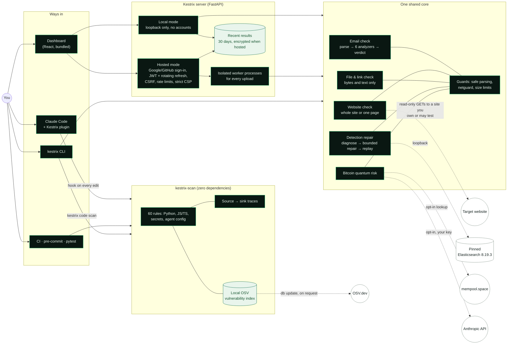

# Kestrix

[](https://github.com/Ruthvik-Bandari/kestrix/actions/workflows/ci.yml)


**Security checks for your code, and a local-first security workbench.** Everything runs on your own machine.

### Scan your code: `kestrix-scan`

A small, fast scanner for insecure Python, JavaScript and TypeScript code, hard-coded secrets and vulnerable or malicious dependencies, with **no dependencies** on Python
3.11 and newer (only `tomli` on 3.10). It works in the terminal, CI, pre-commit and pytest, and inside Claude
Code, where it has Claude fix what it finds as it writes code.

```bash
pip install kestrix-scan
kestrix-scan src                          # exit 1 on high or critical findings
kestrix-scan init --ci github --pre-commit   # [tool.kestrix] config, SARIF upload workflow, pre-commit hook
kestrix-scan install-claude-plugin        # the Claude Code plugin: scan every file Claude writes
kestrix-scan db update                    # download the OSV data once (the only network step); lockfiles are then checked offline
```

Its page, with configuration, CI, pytest and the plugin: [packages/kestrix-scan/README.md](packages/kestrix-scan/README.md).
Until the first PyPI release, install it with
`pip install "git+https://github.com/Ruthvik-Bandari/kestrix#subdirectory=packages/kestrix-scan"`.

### The full workbench: `kestrix`

It fixes broken threat detections, inspects suspicious files and links, checks your website's defences,
reads suspicious emails, and tells you whether your Bitcoin addresses are exposed to future quantum
attacks, through one `pip install`, a CLI and a dashboard. It includes `kestrix-scan`.

```bash
pip install kestrix
kestrix dashboard            # opens http://localhost:8765
```

| Module | Who it helps | What it does |
| --- | --- | --- |
| **Detection repair** | SOC analysts, detection engineers, researchers | Diagnoses why a Sigma rule misses attacks or fires on benign activity, proposes the smallest safe fix, and proves it by replaying labeled events on a pinned Elasticsearch. |
| **File and URL forensics** | Students, everyday users, incident responders | Hashes a file, measures entropy to spot packed or encrypted content, detects disguised file types, flags GPS data in photos, and scores links for phishing signs without opening them. |
| **Website check** | Small site owners, developers | Grades the HTTPS, TLS, security headers and cookie settings of a site you own, and gives a concrete fix for each problem. |
| **Mail analysis** | Everyday users, help desks, incident responders | Checks a saved email (`.eml`) offline: sender authentication results, mismatched sender addresses, look-alike domains, deceptive links, risky attachments and scam wording, with a reason for every finding. |
| **Code security scanning** | Developers, reviewers, people coding with AI assistants | Finds shell and SQL injection, unsafe deserialization, disabled TLS checks, weak hashes and randomness, and hard-coded secrets in source code, with a CWE and a fix for every finding; exits non-zero for CI. |
| **Bitcoin quantum risk** | Bitcoin holders | Explains which address types reveal public keys that a future quantum computer could attack, and how to move funds to a safer address. |

> Use Kestrix only on systems, files and websites you own or are authorized to assess.

---

## Contents

- [Install](#install)
- [Quick start](#quick-start)
- [Detection repair](#detection-repair)
- [Forensics](#forensics)
- [Website check](#website-check)
- [Mail analysis](#mail-analysis)
- [Code security scanning](#code-security-scanning)
- [Bitcoin quantum risk](#bitcoin-quantum-risk)
- [Use Kestrix from Claude](#use-kestrix-from-claude)
- [Claude Code plugin](#claude-code-plugin)
- [Security and privacy model](#security-and-privacy-model)
- [Architecture](#architecture)
- [Development](#development)
- [Roadmap](#roadmap)
- [Credits and license](#credits-and-license)

## Install

Requires Python 3.10 or newer.

```bash
pip install kestrix-scan            # only the code scanner and the Claude Code plugin; no dependencies
pip install kestrix                 # core: all six modules (incl. the code scanner) and the dashboard
pip install "kestrix[exif]"         # + photo metadata (Pillow)
pip install "kestrix[ai]"           # + the optional AI guardian (bring your own Anthropic key)
```

Detection repair replays rules on a real search engine. Start the pinned Elasticsearch once with Docker:

```bash
kestrix detect engine-up      # docker run of elasticsearch 8.19.3, bound to 127.0.0.1:9200
kestrix detect engine-status
```

## Quick start

```bash
kestrix dashboard                                   # everything in the browser
kestrix forensics file ~/Downloads/invoice.pdf      # hashes, entropy, type check
kestrix forensics url "http://paypa1-login.example.top/verify"
kestrix webcheck scan https://your-site.example
kestrix mail analyze ~/Downloads/message.eml     # offline email checks
kestrix-scan src                                 # insecure code and hard-coded secrets
kestrix bitcoin scan bc1q... 1A1zP1eP5QGefi2DMPTfTL5SLmv7DivfNa
kestrix detect cases                                # 11 bundled demonstrations
kestrix detect demo c03-noise-updater-temp
```

Add `--json` to any command for machine-readable output. Exit codes are stable, so you can use the
commands in scripts and CI.

## Detection repair

Detections break quietly. A log pipeline renames a field, a software updater starts matching, or a
condition has a typo. Kestrix takes a **Sigma rule**, an **environment field mapping** and **labeled
JSONL events**, then:

1. **Parses safely** a bounded, single-event subset of Sigma: `process_creation` on Windows, exact /
   `contains` / `startswith` / `endswith` matches (optionally `|all`), value lists, lists of field maps, and
   `and` / `or` / `not` conditions with `1 of` / `all of` quantifiers.
   Anything else is rejected with a reason code instead of being guessed at.
2. **Profiles the telemetry.** For each field it reports which fields the rule needs, which are present,
   and which are missing.
3. **Replays the rule on a pinned Elasticsearch 8.19.3.** It loads the events into a disposable index,
   runs the exact query pySigma generates, and paginates until it has every match. Conversion success is
   never treated as proof that a detection works.
4. **Diagnoses the failure family:** mapping drift, missing telemetry, noise or logic. When the evidence
   is ambiguous it returns several hypotheses.
5. **Proposes bounded repairs.** Allowed changes are one mapping entry, a narrow benign exclusion, a
   modifier fix or a condition fix, with at most three AST edits. A repair may never drop a selection or
   delete the condition.
6. **Validates on held-out events.** The best development candidate is frozen, then validated once on
   a separate, non-overlapping fixture set. It must detect every attack scenario, lose none that the
   original caught, and match no more benign events than the healthy reference. If it fails, the
   tool **abstains**. If the telemetry was never collected, it says so and recommends collecting it.

```text
$ kestrix detect demo c03-noise-updater-temp
outcome: repaired
finding: noise [benign_events_matched] c03d-u1, c03d-u2, c03d-u3
original development: TP=3 FP=4 FN=0 TN=4
original validation: TP=4 FP=5 FN=0 TN=4
candidate b0-noise-1: passed
candidate b0-noise-2: screened
--- a/rule.yml
+++ b/rule.yml
+  cg_filter_1:
+    ParentImage: C:\Program Files (x86)\Google\Update\GoogleUpdate.exe
+  condition: selection and not cg_filter_1
```

| Outcome | Meaning | Exit code |
| --- | --- | --- |
| `repaired` | A candidate passed validation; diff and artifact hash included | 0 |
| `unchanged` | The rule already meets expectations | 0 |
| `abstained` | No candidate passed the policy | 10 |
| `insufficient_evidence` | Required fields are not collected; telemetry guidance included | 10 |
| `unsupported` | The rule uses semantics outside the supported subset | 11 |
| `engine_unavailable` | Elasticsearch is not reachable; static coverage still reported | 3 |

Run it on your own data with `kestrix detect run --rule r.yml --mapping m.yml --dev dev.jsonl
--validation val.jsonl`. The fixture format, the mapping format and the semantics are documented in
[docs/modules/detect.md](docs/modules/detect.md). The 11 bundled cases are synthetic unit-level
demonstrations: one healthy control, two mapping drifts, two noise cases, two missing-telemetry cases,
three logic faults and one unsupported rule. They are not a benchmark result.

## Forensics

```bash
kestrix forensics file suspicious.exe --json
kestrix forensics url "https://xn--pple-43d.com/login"
```

- **File analysis:**
  - computes MD5, SHA-1, SHA-256 and SHA-512 in one streaming pass
  - measures Shannon entropy for the whole file and per block, so you can spot packed or encrypted
    regions
  - builds a byte histogram
  - detects the real type from magic bytes and warns when the extension disagrees
  - reads EXIF metadata, including a privacy warning when a photo carries GPS coordinates
  - never executes the file
- **URL analysis:** checks a link for phishing signs offline; the link is never fetched. It looks for:
  - IP-literal hosts
  - punycode and look-alike letters
  - brand names in subdomains
  - URL shorteners
  - credentials embedded in the URL
  - suspicious top-level domains

  The score is a heuristic, not a probability.

## Website check

```bash
kestrix webcheck scan https://your-site.example
```

By default the check covers the whole site: up to 50 read-only GET requests to the page you name, the pages it
links to, its sitemap's pages and six common login addresses (each request and redirect re-validated), and one
TLS handshake. `--page-only` sends one GET request (following up to five redirects) instead. It never submits
forms, logs in, follows links to other sites, fuzzes or scans ports. It covers:

- **HTTPS and TLS:** HTTPS enforcement, TLS version, and certificate validity, expiry and hostname.
- **Headers:** HSTS, CSP (including `unsafe-inline` and wildcard sources), clickjacking protection,
  `X-Content-Type-Options`, `Referrer-Policy`, `Permissions-Policy` and COOP.
- **Information leaks:** version strings in server headers.
- **Cookies:** `Secure`, `HttpOnly` and `SameSite` on every cookie.

The result is an A–F grade from a documented rubric ([grade.py](src/kestrix/webcheck/grade.py)).

Private, loopback and cloud-metadata addresses are refused unless you pass `--allow-private` for a lab
host you own.

## Mail analysis

```bash
kestrix mail analyze message.eml --protected-domain example-bank.com
```

Save a message as `.eml` from your mail client and Kestrix checks it without sending anything anywhere:

- **Authentication:** SPF, DKIM and DMARC from the `Authentication-Results` header your provider added
  (only the topmost one, or one from an `authserv-id` you trust).
- **Sender:** Reply-To or Return-Path on another domain, and display names that show a different address
  or the name of a domain you protect.
- **Links:** link text that shows one site while the link opens another, credentials before `@`,
  `javascript:` and `data:` links, IP and punycode hosts, shorteners and redirect parameters.
- **Attachments:** executable and script types, double extensions such as `invoice.pdf.exe`, content
  that does not match its name, macro-enabled Office files, and encrypted or program-carrying ZIPs
  (listed, never extracted).
- **Look-alike domains:** From and link domains that imitate a protected domain, such as `paypa1.com`,
  `rnicrosoft.com`, a Cyrillic `pаypal.com` or `paypal.com.account-verify.example`, and names that mix
  alphabets.
- **Wording (heuristic):** English cues of payment or bank-detail changes, gift-card requests, urgency,
  secrecy and sign-in requests, and the payment-plus-pressure pattern of business email compromise.

In the dashboard, the **Email check** page does the same: drop an `.eml` file, optionally list protected
domains, and read the verdict and findings. The file goes only to the local Kestrix server.

The verdict is `clean`, `suspicious`, `malicious` or `insufficient_evidence`, with every finding explained.
HTML is never rendered, links are never visited and attachments are never opened. The score is a heuristic,
not a probability, and no detection rates are claimed yet. Details: [docs/modules/mail.md](docs/modules/mail.md).

## Code security scanning

```bash
kestrix-scan src                                    # text report; exit 1 on high or critical findings
kestrix-scan . --format sarif --output kestrix.sarif
kestrix-scan . --diff origin/main --fail-on medium
```

The scanner is the `kestrix-scan` package; inside the workbench, `kestrix code scan` runs the same command
with the same options.

Kestrix reads your code as data (Python through the standard-library `ast`, never imported or run) and reports:

- **Python:** `eval`/`exec` of non-literals, `shell=True` and `os.system` with built commands, pickle and
  unsafe YAML loading, SQL built with f-strings or concatenation, `verify=False` and other disabled TLS
  checks, MD5/SHA-1, `random` used for tokens, `tempfile.mktemp`, Flask debug mode, unverified JWTs,
  stdlib XML parsing, `assert` used for access checks and file paths taken from request data.
- **Any text file:** AWS, GitHub, Slack, Stripe, Google, Anthropic and OpenAI-style keys, private keys,
  JWTs, and high-entropy values assigned to names like `password` or `api_key`. Reports show only the
  kind and the first four characters, never the secret.
- **Lockfiles:** pinned versions in `requirements*.txt`, `uv.lock`, `poetry.lock`, `pdm.lock`,
  `Pipfile.lock`, `package-lock.json`, `yarn.lock`, `pnpm-lock.yaml`, `bun.lock`, `composer.lock`, `go.mod`, `Cargo.lock`,
  `pom.xml`, `Gemfile.lock`, `packages.lock.json` and `pubspec.lock` with known vulnerabilities
  (`dep.vulnerable`) or reported as malware (`dep.malicious`), checked against a local OSV index that
  `kestrix-scan db update` downloads. Scans themselves stay offline.

Every finding has a rule id, CWE, severity, confidence, location, why it matters and a fix. Exit codes are
0 (nothing at or above `--fail-on`), 1 (findings) and 2 (usage error). Output is text, JSON or SARIF 2.1.0
for GitHub code scanning. Silence a false positive with `# kestrix: ignore[rule-id] reason` (the reason
is required), adopt existing code with `--write-baseline` and `--baseline`, and use `--hook` from a Claude
Code `PostToolUse` hook (the [Claude Code plugin](#claude-code-plugin) sets that up).

Settings live in `[tool.kestrix]` in `pyproject.toml` (or `.kestrix.toml`): `fail-on`, `exclude`,
`rules.enable` / `rules.disable` and `baseline`, with command-line flags taking precedence.
`kestrix-scan init` writes them, a pre-commit entry and a GitHub workflow that uploads SARIF;
`pytest --kestrix` adds a scan to a test run. From Python: `kestrix_scan.scan(["src"])` (`kestrix.code` still
works). The rules are pattern analysis and miss things; no detection rates are claimed. Details:
[docs/modules/code.md](docs/modules/code.md).

## Bitcoin quantum risk

```bash
kestrix bitcoin scan bc1p... 1BoatSLRHtKNngkdXEeobR76b53LETtpyT --lookup-chain
kestrix bitcoin migration p2tr
kestrix bitcoin ask "is my taproot address safe from quantum computers?"   # needs [ai] + your key
```

Kestrix decodes Base58Check and Bech32/Bech32m addresses itself; both are tested against the BIP-173
and BIP-350 test vectors. It then explains each address's exposure:

- **Raw public keys (P2PK):** always exposed.
- **Taproot (P2TR):** shows a tweaked public key on-chain.
- **Hash-based types (P2PKH, P2WPKH, P2SH, P2WSH):** hide the key until the first spend.

`--lookup-chain` asks mempool.space whether an address has ever spent, which would have revealed its key.
This sends the address to that service, so it is off by default. **Kestrix never asks for private
keys or seed phrases.**

The optional AI guardian uses your own Anthropic API key. It only classifies what you are asking for.
It cannot move funds or run commands, and every address it returns is re-validated locally.

```bash
pip install "kestrix[ai]"
kestrix config set-anthropic-key       # stored in ~/.config/kestrix/secrets.json (mode 0600)
```

## Use Kestrix from Claude

Kestrix includes a Claude skill, `kestrix-security`, so you can ask Claude Code "Is this email a phish?
~/Downloads/invoice.eml" or "Why didn't my Sigma rule fire?" and Claude runs the right `kestrix` command
locally, reads the JSON and explains the verdict, the main reasons and what to do next.

```bash
kestrix-scan install-claude-skill                           # into ~/.claude/skills/kestrix-security
kestrix-scan package-claude-skill --out kestrix-security.zip   # to upload in Claude.ai or Claude Desktop
```

`kestrix integrations install-claude-skill` and the other `kestrix integrations` commands do the same.

The skill keeps everything on your machine, never opens links or runs files, treats email and file content
as untrusted data, and checks only websites you own. Details and example prompts:
[docs/claude-skill.md](docs/claude-skill.md). In Claude Code, the plugin below includes this skill and is
the recommended way to install it.

## Claude Code plugin

The `kestrix` plugin makes Claude Code scan every file it writes. A `PostToolUse` hook on `Write`, `Edit`,
`MultiEdit` and `NotebookEdit` runs `kestrix-scan --hook` (or, with only the workbench installed,
`kestrix code scan --hook`) on the changed file. Findings at medium
severity or above go back to Claude with the rule, the CWE and the fix, and Claude fixes them in the same
turn. It suppresses a finding only when it is a confirmed false positive, with a written reason.

```bash
pip install kestrix-scan                             # or: uv tool install kestrix-scan
kestrix-scan install-claude-plugin                   # copies the plugin to ~/.claude/kestrix-plugin
claude plugin marketplace add ~/.claude/kestrix-plugin
claude plugin install kestrix@kestrix-local
```

Once this repository is public: `/plugin marketplace add Ruthvik-Bandari/kestrix`, then
`/plugin install kestrix@kestrix`.

The plugin also includes:

- **Skills:** `secure-code-review`, a per-rule `fixing-security-findings` playbook, and `kestrix-security`.
- **Commands:** `/kestrix:scan`, `/kestrix:fix` and `/kestrix:review` (the review covers the current git diff).
- **An opt-in Stop gate:** with `KESTRIX_BLOCK_ON_STOP=1`, or `{"claude": {"block_on_stop": true}}` in
  `.kestrix.json`, Claude cannot finish while high or critical findings remain in the files it changed.

Everything runs locally, and the hooks fail open. When neither `kestrix-scan` nor `kestrix` is installed, the plugin shows one
hint per session and never blocks an edit. Findings never include secret values. Details:
[docs/claude-plugin.md](docs/claude-plugin.md).

## Security and privacy model

- **Local by default.** The dashboard binds to `127.0.0.1` and refuses requests whose `Host` header is
  not a loopback name. That blocks DNS-rebinding attacks from web pages you visit. Responses carry a
  strict CSP, `frame-ancestors 'none'`, `nosniff` and `no-referrer`.
- **Untrusted input stays data.** YAML is loaded with a safe loader that also rejects aliases and tags.
  JSONL and uploads are size- and depth-limited. Uploaded files are never executed, and rule text is
  never interpreted as an instruction.
- **Outbound requests are opt-in and guarded.** Only http(s) URLs are allowed. Each resolved IP is
  checked against private, loopback, link-local and metadata ranges, and the connection goes to that
  validated IP so a DNS change between check and connect cannot bypass the check. Redirects are
  re-validated hop by hop.
- **Secrets stay on your machine.** API keys come from the environment or a 0600 file. They are never
  returned by the API or written to logs or evidence.
- **Honest results.** Engine errors are reported as errors, never as "no match". Heuristic scores are
  labeled as heuristics. A passed validation suite establishes behavior only on the scenarios it tested.

Report vulnerabilities as described in [SECURITY.md](SECURITY.md).

### Hosted mode (preview)

Kestrix can also run as a public website with Google or GitHub sign-in (`kestrix serve-hosted`), serving the
website check, forensics and the email check. It is opt-in and not yet ready for launch. Setup and its security
properties are in [docs/hosted.md](docs/hosted.md).

## Architecture

Every way of using Kestrix reaches the same core functions, so a result is the same from the CLI, the dashboard, the
hosted service or Claude Code. Dashed lines leave your machine, and only when you ask for it.



| Boundary | What crosses it |
| --- | --- |
| Your machine → the internet | Nothing by default. Website checks, the Bitcoin chain lookup, the AI guardian and `db update` connect only when you start them. |
| Browser → hosted server | Your upload or URL, over HTTPS with sign-in, CSRF and rate limits. Uploads are processed in a worker and never stored; the report is kept 30 days, encrypted. |
| Claude Code → kestrix-scan | The files Claude edits, scanned locally; only new findings go back to Claude as context. |

The design decisions are recorded in [docs/adr](docs/adr). The research plan behind detection repair is in
[docs/CyberGuard_Engineering_Plan.md](docs/CyberGuard_Engineering_Plan.md).

## Development

```bash
git clone https://github.com/Ruthvik-Bandari/kestrix.git kestrix
cd kestrix
uv sync --all-extras
uv run kestrix detect engine-up       # for the engine-backed tests
uv run pytest                           # both packages; engine tests skip if Elasticsearch is down
uv run ruff check . && uv run ruff format --check . && uv run mypy

cd frontend && npm ci && npm run dev    # dashboard with hot reload, proxied to the API on :8765
npm run build                           # writes the bundle into src/kestrix/server/static
```

The repository is a uv workspace: the `kestrix` workbench at the root and `kestrix-scan` in
`packages/kestrix-scan/`. Releases are described in [docs/release.md](docs/release.md). See
[CONTRIBUTING.md](CONTRIBUTING.md) for conventions. The Claude Code development workflow used on
this project is in [docs/claude](docs/claude).

## Roadmap

Detection repair follows the staged research plan:

- **Shipped:** B0, deterministic mapping and diagnostics.
- **Next:** B1 (retrieval of reviewed repairs) and B2 (an unmodified open model with structured output).
- **Then:** M1 (LoRA fine-tuning on university GPUs) and M2 (a learned ranker with execution features).

Each stage ships only if it beats the previous one on frozen, root-grouped splits. If adaptation does not
help, the stronger baseline ships, and the negative result is published.

The benchmark tooling lives in `src/kestrixbench/`, a research package that is not shipped in the wheel. It fetches the
pinned public sources (SigmaHQ, OTRF Security-Datasets, Atomic Red Team), records license and hash
manifests, and writes aggregate QC reports. Related docs:

- [docs/data/sources.md](docs/data/sources.md): the license record.
- [docs/data/policy.md](docs/data/policy.md): the data and model guardrails.
- [docs/data/compliance.md](docs/data/compliance.md): the approvals checklist.
- [docs/hpc.md](docs/hpc.md): cluster jobs and choosing GPUs by task.
- [docs/research.md](docs/research.md): the research pipeline end to end (benchmark → B0/B1/B2 → M1 → locked comparison).
- [docs/data/dataset-card.md](docs/data/dataset-card.md) and [docs/model-card.md](docs/model-card.md): the benchmark and the M1 adapter, with results and limitations.

## Credits and license

- **Detection-repair research workbench, platform architecture and implementation:** Ruthvik Bandari.
- **Forensics module:** adapted from [CyberSafeX Detection Suite](https://github.com/Ruthvik-Bandari/CyberSafeX-Detection-Suite) (MIT).
- **Bitcoin module:** adapted from [BitShield](https://github.com/Ruthvik-Bandari/MIT-BTC-Hackathon-Team_ACE), built by Team ACE at the MIT Bitcoin Expo 2026 hackathon.
- **Built on:** [pySigma](https://github.com/SigmaHQ/pySigma) and the pySigma Elasticsearch backend.

Licensed under the [Apache License 2.0](LICENSE). See [NOTICE](NOTICE) and [docs/provenance.md](docs/provenance.md) for authorship evidence.
