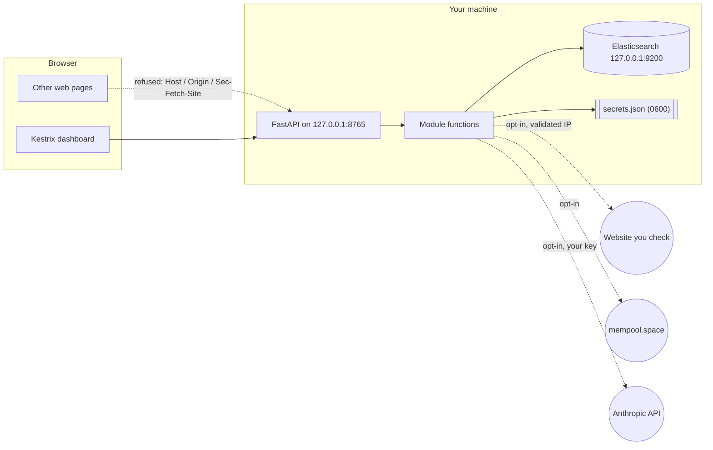

# Security model

This page explains what Kestrix protects, what it assumes, and where its protections stop. Read it before you run Kestrix on a shared machine, expose the dashboard beyond loopback, or feed it files and rules from people you do not trust. It is written for users who want to know what leaves their computer, and for reviewers who want to check the claims against the code. Each mitigation names the file that implements it.

To report a vulnerability, see [SECURITY.md](../SECURITY.md).

## What Kestrix is

Kestrix is a single-user tool that runs on your own computer. It has two front ends over one set of module functions:

- the `kestrix` CLI;
- a FastAPI server, started by `kestrix dashboard`, that serves a bundled React dashboard and a JSON API on `127.0.0.1:8765`.

There are no accounts and no background jobs in the default local mode. Its only database is the result history: the last 30 days of reports, plaintext, in your `0600` config folder (turn it off in Settings). The opt-in hosted mode, which has accounts and a database, is covered in [Hosted mode](#hosted-mode-preview). Detection repair talks to a local Elasticsearch container. Three features reach the internet, and all only when you ask: the website check contacts the site you name, the Bitcoin module contacts mempool.space and the Anthropic API, and the optional mailbox connector contacts Google or Microsoft (local mode only, [ADR 0009](adr/0009-mailbox-connector.md)).

## Assets

| Asset | Why it matters |
| --- | --- |
| Your machine and local network | A local server can be abused to attack the host or reach internal services. |
| Files you analyse, rules and fixtures | They may hold private data, and they may be hostile. |
| Your Anthropic API key | It costs money and identifies your account. |
| Your Bitcoin addresses | Revealing them together can link them to you. |
| Your mailbox access (optional connector) | A refresh token lets anyone holding it read your mail until you revoke it. |
| Integrity of results | A wrong "repaired" or "safe" result leads to bad decisions. |

## Adversaries and threats

| Adversary | Example threats |
| --- | --- |
| A web page open in your browser | DNS rebinding against the local server; cross-site form posts (CSRF); framing the dashboard |
| A hostile file, rule, mapping or fixture | YAML alias bombs and tag-based object construction, deeply nested JSON, oversized input, path traversal in case IDs or upload names, decoder bugs in image parsing |
| A website you check, or its DNS | Redirects to internal addresses (SSRF), DNS answers that change between check and connect, oversized responses |
| An upstream service (mempool.space, Anthropic) | Malformed or oversized responses; a model that returns invented addresses or follows instructions hidden in your message |
| Another local user or process | Reading stored secrets; calling the unauthenticated local API |

## Trust boundaries

Data crosses a boundary at each of these points:

1. Browser to local server.
2. User input to parser.
3. Core to the local engine.
4. Core to the internet.
5. Model output back into Kestrix.

## Mitigations

### Local server

| Control | Implementation |
| --- | --- |
| Binds to `127.0.0.1` by default | `dashboard` command in [`cli.py`](../src/kestrix/cli.py) |
| `Host` must be `127.0.0.1`, `localhost` or `[::1]` (HTTP 421 otherwise), which blocks DNS rebinding | `_LocalOnly` in [`server/app.py`](../src/kestrix/server/app.py) |
| Non-`GET`/`HEAD`/`OPTIONS` requests refused when `Sec-Fetch-Site` is cross-site or `Origin` is not an allowed host (HTTP 403) | `_LocalOnly._cross_site` in [`server/app.py`](../src/kestrix/server/app.py) |
| No CORS headers, so other origins cannot read responses | [`server/app.py`](../src/kestrix/server/app.py) (no CORS middleware) |
| Declared body size capped per route (1 MiB default, 60 MiB detect run, 51 MiB file upload, 26 MiB mail upload) | `MAX_BODY_BYTES`, `LARGE_BODY_ROUTES` in [`server/app.py`](../src/kestrix/server/app.py) |
| Upload size counted while streaming; file held in an anonymous spooled temp file and never executed | [`forensics/api.py`](../src/kestrix/forensics/api.py) |
| Strict CSP (`script-src 'self'`, `style-src 'self'`, `object-src 'none'`, `base-uri 'none'`, `frame-ancestors 'none'`; no `unsafe-inline` or `unsafe-eval`), `X-Frame-Options: DENY`, `nosniff`, `no-referrer`, COOP and CORP `same-origin`, a minimal `Permissions-Policy` on every response; content-hashed `/assets/` served `immutable`, a missing asset is a 404 | [`server/headers.py`](../src/kestrix/server/headers.py), `_serve_static` in [`server/app.py`](../src/kestrix/server/app.py); `tests/server/test_site_hardening.py` |
| Static file paths resolved and confined to the bundle directory; a NUL byte or an over-long name is a missing file, not a server error | `_serve_static` in [`server/app.py`](../src/kestrix/server/app.py) |
| Errors returned as `{reason, detail}`, never stack traces; an unexpected exception becomes a JSON 500 `internal_error` that still carries the security headers | Exception handlers and `_LocalOnly` in [`server/app.py`](../src/kestrix/server/app.py) |

### Untrusted input

| Control | Implementation |
| --- | --- |
| YAML loaded with a safe loader that also refuses aliases, explicit tags and duplicate keys; one document; 100 KiB; depth 16 | [`core/safe_load.py`](../src/kestrix/core/safe_load.py) |
| JSONL bounded at 250 MiB per file, 1 MiB per line, depth 16 | [`core/safe_load.py`](../src/kestrix/core/safe_load.py) |
| Sigma rules parsed against an explicit allowlist; anything else rejected with a reason code | [`detect/rule.py`](../src/kestrix/detect/rule.py) |
| Repair candidates validated as a strict envelope, bounded to 3 AST edits, re-parsed after patching | [`detect/candidate.py`](../src/kestrix/detect/candidate.py) |
| Case IDs resolved and confined to the bundled cases directory | [`detect/cases.py`](../src/kestrix/detect/cases.py) |
| The engine loader writes only to disposable `cg-replay-*` indexes and deletes them after each run | [`detect/engine.py`](../src/kestrix/detect/engine.py) |
| Rule text, event data and model text are data. No content is evaluated, executed or followed as instructions | Throughout; the dashboard renders them as text |
| Uploaded file names reduced to a printable base name | `display_name` in [`forensics/analysis.py`](../src/kestrix/forensics/analysis.py) |
| Image metadata read with Pillow restricted to four formats, pixel data never decoded, a pixel-count ceiling | [`forensics/exif.py`](../src/kestrix/forensics/exif.py) |
| URL forensics never fetches or resolves the URL | [`forensics/url.py`](../src/kestrix/forensics/url.py) |
| Code scanning reads files as bytes and parses Python with `ast`, never importing or running it; skips files over 1 MiB, binary files and links out of the scan root, stops at 20,000 files, bounds recursion; runs git only with fixed argument lists (refs starting with `-` refused); never writes secret values to any output, only their kind and first four characters; the hook mode fails open | [`code/walk.py`](../src/kestrix/code/walk.py), [`code/python_rules.py`](../src/kestrix/code/python_rules.py), [`code/secrets.py`](../src/kestrix/code/secrets.py), [`code/analyze.py`](../src/kestrix/code/analyze.py) |
| Email messages parsed with caps on size (25 MiB), headers, MIME depth and parts, decoded text and links; header blocks (64 KiB each, 1 MiB in total) and MIME parameters (50 per `Content-Type` or `Content-Disposition`) are capped on the raw bytes before the standard library parses them, and header nesting that exhausts its recursion is rejected; HTML tokenized for links and text only, never rendered; links never visited; archives listed from the central directory, never extracted; reports carry no body or attachment bytes beyond an intent cue phrase of at most 60 characters | [`mail/parse.py`](../src/kestrix/mail/parse.py), [`mail/analyzers.py`](../src/kestrix/mail/analyzers.py), [`mail/intent.py`](../src/kestrix/mail/intent.py) |

### Outbound requests

| Control | Implementation |
| --- | --- |
| Only `http`/`https` with a host, at most 2,048 characters, no credentials in the URL | `check_url` in [`core/netguard.py`](../src/kestrix/core/netguard.py) |
| Every resolved address must be global unicast: no private, loopback, link-local (including cloud metadata), multicast or reserved ranges, including IPv4 embedded in IPv6 (mapped, 6to4, NAT64, IPv4-compatible). `--allow-private` lifts this for one run. | [`core/netguard.py`](../src/kestrix/core/netguard.py) |
| Website check connects to the validated IP, keeping the hostname in `Host` and SNI, so DNS changes after the check cannot redirect it | [`webcheck/fetch.py`](../src/kestrix/webcheck/fetch.py) |
| Each redirect re-validated; at most 5; 10 s for the whole fetch including DNS, enforced on every socket operation, and 10 s for the TLS handshake; 1 MiB read per response; no environment proxies; no cookie is ever sent back (the client's cookie jar accepts and returns nothing) | [`webcheck/fetch.py`](../src/kestrix/webcheck/fetch.py), `check_url` in [`core/netguard.py`](../src/kestrix/core/netguard.py) |
| Website check, whole-site scope: only GET, never a form, body, credential or cookie; only pages named by the start page's links, `/sitemap.xml` or six fixed login addresses, on exactly the start page's scheme, host and port; a redirect to another origin is reported and not followed; every request and hop passes `check_url` (and the 80/443 rule when hosted); at most 50 pages plus 15 extra requests (sitemap and redirects), 60 s for the crawl, 150 ms between sequential requests, 1 MiB per response; links and sitemap read with `html.parser` and `str.find`, so no entity or DTD is resolved | [`webcheck/crawl.py`](../src/kestrix/webcheck/crawl.py), [`webcheck/fetch.py`](../src/kestrix/webcheck/fetch.py) |
| Mailbox connector (local mode only, ADR 0009): HTTPS to port 443 of five fixed hosts only (`accounts.google.com`, `oauth2.googleapis.com`, `gmail.googleapis.com`, `login.microsoftonline.com`, `graph.microsoft.com`), no credentials in the URL, every request through `check_url`, redirects refused, 20 s timeout, 1 MiB per JSON answer and the 25 MiB message cap for raw mail, a Graph next-page link accepted only if it is a `graph.microsoft.com/v1.0/me/` URL; httpx's own request log lines for these hosts are dropped because their URLs hold search text and message ids | [`mail/mailbox/http.py`](../src/kestrix/mail/mailbox/http.py), [`mail/mailbox/providers.py`](../src/kestrix/mail/mailbox/providers.py) |
| Mailbox sign-in: authorization code with PKCE (`S256`) and a loopback redirect; `state` is 256 bits, held in memory for 10 minutes (at most 8 pending), single use, and bound to the browser that started it by an `HttpOnly`, `SameSite=Strict` cookie compared in constant time; the code is exchanged in a `POST`, never in a `GET`; the granted scope must include the read-only mail scope; the access token lives in memory only | [`mail/mailbox/service.py`](../src/kestrix/mail/mailbox/service.py), [`mail/mailbox/oauth.py`](../src/kestrix/mail/mailbox/oauth.py), [`mail/mailbox/api.py`](../src/kestrix/mail/mailbox/api.py) |
| The mailbox routes do not exist on the hosted service: not registered, `HostedGate` answers 404 for `/api/mail/mailbox`, and the dashboard does not render the connector | `create_app` in [`server/app.py`](../src/kestrix/server/app.py), `LOCAL_ONLY_PREFIXES` in [`server/hosted.py`](../src/kestrix/server/hosted.py); `tests/server/test_mailbox_hosted.py` |
| mempool.space lookups validated, no redirects, 10 s timeout, 64 KiB response cap, schema-checked | [`bitcoin/chain.py`](../src/kestrix/bitcoin/chain.py) |
| Engine client never follows redirects | [`detect/engine.py`](../src/kestrix/detect/engine.py) |

### Model output

| Control | Implementation |
| --- | --- |
| The guardian only classifies a message into a fixed schema. It cannot run commands or move funds. | [`bitcoin/guardian.py`](../src/kestrix/bitcoin/guardian.py) |
| Addresses from the model are kept only if they appear verbatim in your message and pass the local parser | `_validated_addresses` in [`bitcoin/guardian.py`](../src/kestrix/bitcoin/guardian.py) |
| The next-step text comes from Kestrix; the model summary is labeled as model-written and cut to 500 characters | [`bitcoin/guardian.py`](../src/kestrix/bitcoin/guardian.py), [`bitcoin/cli.py`](../src/kestrix/bitcoin/cli.py) |

### Result integrity

| Control | Implementation |
| --- | --- |
| The pinned engine is the only matching oracle; the version is checked on every run | [`detect/engine.py`](../src/kestrix/detect/engine.py) |
| Engine and conversion errors are reported as errors with `counts: null`, never as zero matches | [`detect/replay.py`](../src/kestrix/detect/replay.py) |
| Pagination retrieves every hit, or fails | `search_ids` in [`detect/engine.py`](../src/kestrix/detect/engine.py) |
| The candidate is selected on development fixtures and frozen before validation; validation fixtures must share no events with development | [`detect/workflow.py`](../src/kestrix/detect/workflow.py) |
| Explicit `abstained`, `unsupported` and `insufficient_evidence` outcomes instead of a forced answer | [`detect/workflow.py`](../src/kestrix/detect/workflow.py) |
| Evidence written as content-addressed JSON with an atomic rename | [`core/evidence.py`](../src/kestrix/core/evidence.py) |
| Heuristic scores labeled as heuristics, not probabilities | [`forensics/models.py`](../src/kestrix/forensics/models.py) |

## How secrets are stored

The secrets are the optional Anthropic API key and, if you use the mailbox connector, your own OAuth app's client ID and secret and the refresh token it was issued, stored as `mail_gmail_*` and `mail_outlook_*` entries in the same file ([`core/config.py`](../src/kestrix/core/config.py), [`mail/mailbox/store.py`](../src/kestrix/mail/mailbox/store.py)). The notes below apply to all of them. `kestrix mail disconnect` deletes the refresh token (and revokes it at Google); `GET /api/mail/mailbox/status` reports only whether each is set.

- **Lookup order.** `ANTHROPIC_API_KEY` from the environment first, then the `anthropic_api_key` entry in `secrets.json`.
- **Location.** `secrets.json` lives in the config directory:
  - `$KESTRIX_HOME` if set;
  - otherwise `%APPDATA%\kestrix` on Windows;
  - otherwise `$XDG_CONFIG_HOME/kestrix`, which defaults to `~/.config/kestrix`.
- **Permissions.** The directory is created or tightened to `0700`. The file is written to a new `0600` temporary file (created exclusively with `mkstemp`) and atomically renamed over the old one. On Windows these POSIX modes have limited effect, and the file relies on your profile's default permissions.
- **Format.** Plain JSON. The key is not encrypted and is not stored in the OS keychain. Anyone who can read files as your user can read it.
- **Setting it.** Use `kestrix config set-anthropic-key`, which reads the key without echoing it, or the dashboard settings page (`PUT /api/settings/anthropic-key`, a loopback request).
- **Clearing it.** Use `kestrix config clear-anthropic-key`, or send `null` to the same route.
- **Never returned.** `GET /api/settings` and `kestrix config show` report only whether a key is configured. Kestrix does not write the key to logs or evidence, and it is sent only to the Anthropic API.

## Known limitations

- **A stored refresh token reads your mail.** With the mailbox connector connected, the refresh token in `secrets.json` (plain JSON, `0600`, not in the OS keychain) lets any process running as you read your mail with the read-only scope until you disconnect or revoke it. Disconnect when you are done: `kestrix mail disconnect gmail|outlook`. Microsoft has no revoke call for this sign-in, so removing its access completely also means removing the app at your Microsoft account's app permissions page. The connector is local-only, adds no account to Kestrix, and cannot change mail.
- **Single local user, no authentication.** Any process or user on the machine that can reach `127.0.0.1:8765` can call every route. That includes replacing or clearing the stored API key and running scans that send data to the internet. The key cannot be read back through the API. Do not run the dashboard on a machine you share with people you do not trust.
- **Binding beyond loopback.** `kestrix dashboard --host <interface>` adds that host name to the allowlist and serves the same unauthenticated API to the network. The traffic is plain HTTP. Keep the default unless you have a separate access control in front of it.
- **Browsers and Local Network Access.** Kestrix does not rely on Chrome's Local Network Access (LNA) permission prompt. Browsers without LNA can send requests from any page to `127.0.0.1`, and a user may grant LNA to a page. In both cases the server's own `Host`, `Origin` and `Sec-Fetch-Site` checks still apply. `GET` routes are not refused cross-site, but they have no side effects, and without CORS headers the page cannot read their responses.
- **Guardian output is unverified model text.** `intent` and `model_summary` come from a language model and can be wrong. Prompt injection in your own message can change them. The next step is fixed text from Kestrix, but you should still read it before running any command. Your message is sent to Anthropic.
- **Chain lookups disclose addresses.** `--lookup-chain` sends addresses and your IP to mempool.space. The mempool.space client validates the URL but connects by hostname, unlike the website check, which connects to the validated IP. The target is a fixed public host, so this matters less there.
- **The local engine is unauthenticated.** `detect engine-up` runs Elasticsearch with security disabled on `127.0.0.1:9200`. Local processes can read a replay index while a run is in progress. If a run is killed abruptly, a `cg-replay-*` index can be left behind until you delete it.
- **Evidence files are not access-restricted.** `--evidence-dir` writes reports with your default file permissions. A report holds the full rule and mapping text, field names and counts from the schema profile, matched event IDs, and benign context values used in noise exclusions.
- **Image parsing.** EXIF reading parses untrusted image headers with Pillow. Restricting formats and pixel counts narrows the exposure, but a Pillow vulnerability in header parsing remains a residual risk. Without the `[exif]` extra, Pillow is not used.
- **Heuristics are not verdicts.** The URL score, entropy findings and website grade are signals. A clean result does not mean a file, link or site is safe.
- **Validation covers only its suite.** A `repaired` outcome shows behavior on the labeled scenarios you supplied. The bundled cases are synthetic.
- **The development tooling is not a sandbox.** The Claude Code configuration in `.claude/` denies edits to secrets and protected data paths and blocks writes outside the project. It does not intercept shell commands.

## Hosted mode (preview)

`KESTRIX_MODE=hosted` (or `kestrix serve-hosted`) runs Kestrix as a public website with Google and GitHub sign-in ([ADR 0004](adr/0004-hosted-mode.md), slice H2). Local mode is unchanged. Configuration and operation are in [hosted.md](hosted.md). This section covers what changes in the threat model.

### Additional assets

| Asset | Why it matters |
| --- | --- |
| Accounts and sign-ins | A stolen access or refresh token lets someone act as the user and delete their account. |
| Users' files, messages and URLs | They now belong to strangers, not to the machine's owner. |
| The service's network position and reputation | The website check makes requests on users' behalf and can be abused for scanning. |
| OAuth client secrets, the pepper and the JWT secret | They let an attacker impersonate the service, forge refresh-token hashes or mint access tokens. |

### Additional adversaries

| Adversary | Example threats |
| --- | --- |
| Any internet user | Credential stuffing is not possible (no passwords), but sign-in flooding, scan abuse, upload floods and probing for unauthenticated routes are |
| A malicious web page | Login CSRF (forcing the victim into the attacker's account), cross-site writes, open redirects through `next` |
| Someone with a copy of the database | Replaying refresh tokens, harvesting emails |
| A network attacker between the server and a provider | Forged ID tokens or user info |

### Controls

| Control | Implementation |
| --- | --- |
| Refuses to start without an `https` public origin, a pepper and a different JWT secret of at least 32 bytes each, the `kestrix[hosted]` extra, and at least one complete provider | [`server/settings.py`](../src/kestrix/server/settings.py) |
| `Host` must be the public host; `Origin` on writes must equal the public origin; HSTS (`includeSubDomains`; `preload` only when the owner sets `KESTRIX_HSTS_PRELOAD=1`) and `upgrade-insecure-requests` on every response, plus the existing CSP and headers | `_LocalOnly` in [`server/app.py`](../src/kestrix/server/app.py), `hosted_headers` in [`server/headers.py`](../src/kestrix/server/headers.py) |
| A request body that fails validation is a 422 without the rejected values; sign-in, sign-out, account deletion, refusals and token reuse are logged with a salted user hash and no personal data | `_hosted_validation_error` in [`server/app.py`](../src/kestrix/server/app.py), `kestrix.auth` in [`server/auth.py`](../src/kestrix/server/auth.py) |
| A go-live preflight checks the secrets (length, entropy, distinctness), origin, providers, database permissions, the built bundle, the headers, `/api/health`, private-target refusal and rate limits on the real application, and never prints a secret | [`scripts/deploy_preflight.py`](../scripts/deploy_preflight.py) |
| Detection repair, Bitcoin and the Anthropic-key settings are not mounted and return 404 | [`server/app.py`](../src/kestrix/server/app.py), `HostedGate` in [`server/hosted.py`](../src/kestrix/server/hosted.py) |
| Every `/api/` route needs a valid access token unless it is on a short public list, so new routes are private by default (401); the OpenAPI schema is not served; every `/api/` response is `Cache-Control: no-store` | `HostedGate` in [`server/hosted.py`](../src/kestrix/server/hosted.py), [`server/app.py`](../src/kestrix/server/app.py) |
| Authorization code with PKCE S256, single-use 10-minute `state` stored under a keyed hash, Google `nonce`, and `state` bound to the browser by a `__Host-` cookie | [`server/auth.py`](../src/kestrix/server/auth.py) |
| Google ID-token claims checked (`iss`, `aud`/`azp`, `exp`, `iat`, `nonce`, `email_verified`). The signature is not checked: the token comes directly from Google's token endpoint over verified TLS, as OpenID Connect Core 3.1.3.7 permits. GitHub sign-in needs a primary, verified email. | [`server/auth.py`](../src/kestrix/server/auth.py) |
| Provider requests only to four fixed hosts over https:443, verified TLS, no redirects, no environment proxies, 10 s timeout, 64 KiB cap | `ProviderClient` in [`server/auth.py`](../src/kestrix/server/auth.py) |
| `next` accepts only same-origin paths; `//`, backslashes, control characters, whitespace and absolute URLs fall back to `/app` | `safe_next` in [`server/auth.py`](../src/kestrix/server/auth.py) |
| Access tokens are 15-minute HS256 JWTs verified by PyJWT with the algorithm pinned, `kid`-selected keys (the previous key verifies only), required `iss`/`aud`/`sub`/`sid`/`iat`/`nbf`/`exp`/`jti` and 30 s leeway; `__Host-kx_at`, `Secure`, `HttpOnly`, `SameSite=Lax` (ADR 0007) | [`server/tokens.py`](../src/kestrix/server/tokens.py) |
| Every authenticated request also checks that the token's refresh family is live, through a 30-second in-process cache that logout, deletion and reuse detection update at once | [`server/auth.py`](../src/kestrix/server/auth.py) |
| Refresh tokens are 256-bit random, stored only as HMAC-SHA256 with the pepper, rotated on every refresh, and a reused (already rotated) one revokes its whole family and is logged, except that the immediately previous token presented again within 10 seconds, by the same client fingerprint and before its successor is used, is answered with the same successor (the successor is stored only sealed under the previous token, ADR 0007 amendment 1); `__Host-kx_rt`, `Secure`, `HttpOnly`, `SameSite=Strict`; 7-day idle and 30-day absolute expiry; a new family at every sign-in | [`server/auth.py`](../src/kestrix/server/auth.py), [`server/store.py`](../src/kestrix/server/store.py) |
| A per-family CSRF token, derived from the `sid` with the pepper and never stored, is required in `X-CSRF-Token` on state-changing requests, refresh and logout (403 otherwise) | `HostedGate` in [`server/hosted.py`](../src/kestrix/server/hosted.py) |
| Account deletion removes the user and, by cascade, all of that user's refresh families, and clears the user's rate-limit counters, and needs a sign-in from the last 10 minutes (403 `reauth_required` otherwise); deleted rows are overwritten (`secure_delete`), the WAL is checkpointed and truncated, and user ids are never reused | [`server/store.py`](../src/kestrix/server/store.py), [`server/auth_api.py`](../src/kestrix/server/auth_api.py) |
| Operators can disable an account (`kestrix hosted disable-user`): it cannot sign in and its families are revoked (seen by the running server within 30 seconds) | [`server/cli.py`](../src/kestrix/server/cli.py), [`server/store.py`](../src/kestrix/server/store.py) |
| Rate limits: 20 website checks and 120 analyses per user per hour; 20 sign-in starts and 10 callbacks per IP (IPv6 per /64) per 10 minutes (429 with `Retry-After`). Cross-site sign-in starts that are not top-level navigations are refused before they count. The limiter evicts stale and least recently requested keys first and keeps blocked ones | [`server/ratelimit.py`](../src/kestrix/server/ratelimit.py), [`server/hosted.py`](../src/kestrix/server/hosted.py) |
| Concurrency: one module request at a time per user (429 `busy`), at most 2 analyses and 8 website checks at once (503 `busy`); nothing queues or holds a thread | `HostedGate` in [`server/hosted.py`](../src/kestrix/server/hosted.py) |
| Uploads capped at 10 MiB before and while the body is read; a request body must not pause for more than 10 seconds and must finish within 30 seconds (120 for uploads), else 408 `request_timeout`; uvicorn runs with a 5-second keep-alive timeout, a 16 KiB header limit and 100 connections (proxy header and body timeouts: [deploy.md](deploy.md#slow-requests-and-proxy-timeouts)) | `hosted_body_limits` in [`server/app.py`](../src/kestrix/server/app.py), `hosted_router` in [`forensics/api.py`](../src/kestrix/forensics/api.py) and [`mail/api.py`](../src/kestrix/mail/api.py) |
| Each analysis runs in a fresh worker process with a scrubbed environment (no secrets), `RLIMIT_CPU` 10 s, `RLIMIT_AS` 384 MiB on Linux, no core dumps and a 20 s wall-clock kill; results come back as JSON validated against the report model, never as a pickle | [`server/isolation.py`](../src/kestrix/server/isolation.py) |
| Website check: public targets on ports 80 and 443 only (every hop), one generic message for connection failures, an authorization confirmation per scan, a `User-Agent` with the abuse contact, and a log line with the user hash and a keyed hash of the host for abuse reports | `hosted_router` in [`webcheck/api.py`](../src/kestrix/webcheck/api.py), [`webcheck/fetch.py`](../src/kestrix/webcheck/fetch.py), [`server/app.py`](../src/kestrix/server/app.py) |
| Access logs hold the method, route template, status, duration and a salted user-id hash; never bodies, file names, emails, query strings, cookies or tokens. uvicorn's access log is off. | `AccessLog` in [`server/hosted.py`](../src/kestrix/server/hosted.py), `serve-hosted` in [`cli.py`](../src/kestrix/cli.py) |
| Result history ([ADR 0008](adr/0008-per-user-result-history.md)): only the analysis response is stored, never the upload; reports are encrypted with AES-256-GCM under `KESTRIX_HISTORY_KEY` (kept in the secret store, not the volume) with the row id, user id and tool as associated data; another user's result answers 404; kept 30 days (purged on write and start-up); users can delete results or turn history off, and account deletion deletes it; logs hold only tool and size | [`server/history.py`](../src/kestrix/server/history.py), [`server/history_api.py`](../src/kestrix/server/history_api.py) |
| SQLite file `0600` in a `0700` directory, parameterized queries only | [`server/store.py`](../src/kestrix/server/store.py) |

### Hosted-mode limitations

- **Rate limits are per process by default.** Several workers each count separately unless `KESTRIX_RATE_LIMIT_STORE=sqlite` shares the counters through a file on the same disk (keys are stored only as keyed hashes). Separate machines have separate files. The one-request-per-user slot, the concurrency caps and the 30-second revocation cache stay per process either way. See [hosted.md](hosted.md#limitations).
- **Client IPs behind a proxy.** Without `KESTRIX_TRUST_PROXY_HEADERS=1`, every visitor behind the platform proxy shares one per-IP sign-in limit. With it, the right-most `X-Forwarded-For` entry is trusted, which is correct only behind a proxy that always appends it.
- **The pepper is a single key.** Anyone who has both the database and the pepper can check guesses of refresh tokens, but cannot recover them, since they are 256-bit random. A leaked pepper should be rotated, which signs everyone out.
- **The JWT secret mints access tokens.** Anyone who has it can sign tokens for any live family (the family check still applies, so they also need a `sid`). A leaked secret must be replaced without `KESTRIX_JWT_SECRET_PREVIOUS`, which ends every access token at once.
- **Revocation is cached for up to 30 seconds** in processes other than the one that revoked (today, only operator commands). An access token keeps working for at most that long after its account is disabled from the command line.
- **Tokens are bearer cookies.** Malware or an extension in the user's browser can still use them. `HttpOnly` keeps page scripts from reading them. Reuse detection catches a stolen refresh token only once both the thief and the user have used it; whichever is second ends the family.
- **Uploads are still parsed by the same code as locally.** A parser bug now affects a shared server rather than one person's machine. The worker process limits contain CPU and memory exhaustion, but a memory-safety bug in a C extension would run with the server user's file-system access (the worker shares the uid; there is no seccomp or namespace sandbox).
- **Uploads can touch disk.** Uploads over 1 MiB are spooled to an anonymous temporary file in `/tmp`, which on Fly.io is on the machine's disk, until the request ends.
- **Result reports are kept.** Hosted mode stores each user's reports for 30 days (ADR 0008). They hold the subject and sender of a checked email, the name, hashes and metadata (such as photo GPS) of an analyzed file, and checked URLs. Anyone with both the history database and `KESTRIX_HISTORY_KEY` can read them; the server process holds the key in memory. The list summary (tool, time, verdict, number of findings) is not encrypted. Local history is plaintext in the user's `0600` config folder, protected like the rest of that folder.
- **A 10-second refresh grace window.** Two tabs that refresh in the same instant both get the same new refresh token. For 10 seconds after a rotation, a thief who holds the previous token and sends the same `User-Agent` also gets that successor, and is not flagged by that request; any later use of an older token, or of the previous token after its successor was used, still revokes the family. See [ADR 0007](adr/0007-jwt-access-and-rotating-refresh-tokens.md), amendment 1.
- **Slow headers are the proxy's job.** The app ends a request body that pauses for 10 seconds or takes longer than 30 seconds (120 for an upload), and uvicorn limits keep-alive time, header size and open connections, but uvicorn has no timeout for a slowly sent request line or header block, and a connection that never sends anything occupies a slot until the proxy closes it. Configure the proxy's header and body timeouts ([deploy.md](deploy.md#slow-requests-and-proxy-timeouts)).
- **Re-authentication is a recent sign-in, not a password.** Deleting an account needs a sign-in from the last 10 minutes, but Google or GitHub may complete that sign-in without asking for a password when the browser already has a session with them. It stops a stale or stolen long-lived Kestrix session from deleting the account alone; it does not stop someone who is signed in to the provider in the same browser.
- **Counters reset on restart** with the default in-memory limiter. The SQLite store keeps them across restarts. Concurrency slots always live in memory.
